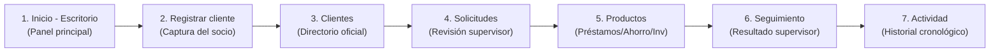

# AGENTS.md · Cooperativa Financiera / BancoMex (BANUAT)

> **Documento de Instrucciones, Arquitectura y Reglas Maestras para Agentes de Inteligencia Artificial**  
> *Aplica para Antigravity, GitHub Copilot (Education / Chat / Workspace) y cualquier otro asistente de desarrollo.*  
> Basado en el **Análisis de Requerimientos v1.0**, las **Historias de Usuario (HU-01 a HU-56)**, las **Especificaciones de Auditoría de Clientes y Reportes**, y los acuerdos formalizados en la **Bitácora de Levantamiento de Requerimientos del 04/11/2026**.  
> **Cualquier agente debe leer y respetar estrictamente este documento antes de sugerir, generar o refactorizar código.**

---

## 1. Visión, Dominio y Contexto del Negocio

El sistema es una **Plataforma Integral de Gestión Bancaria para una Cooperativa Financiera (BANUAT)**, orientada a servicios de ahorro, inversión, préstamos, atención en sucursal y cobranza, bajo estrictos estándares de trazabilidad, integridad contable y auditoría inmutable.

El sistema comprende dos frentes:
1. **Web Interna (Backoffice / Operación de Sucursal):** Utilizada por personal de canalización, ejecutivos de escritorio, cajeros, supervisores, cobranza y administradores.
2. **App del Cliente (Socio):** Interfaz responsive / móvil para socios (consulta de saldos, movimientos, rendimientos, notificaciones, canje de puntos, desglose de beneficios y eventos de educación financiera).

---

## 2. Arquitectura de Repositorio y Stack Tecnológico

```
BancoMex-CdS/
├── .github/
│   └── copilot-instructions.md # Instrucciones automáticas para GitHub Copilot
├── AGENTS.md                    # Este archivo maestro de directrices
├── banco/
│   ├── .github/
│   │   └── copilot-instructions.md # Réplica para Copilot en workspace interno
│   ├── AGENTS.md                # Réplica maestra para navegación interna
│   ├── web-interna/             # Frontend React 19 + TypeScript + Vite + Lucide Icons
│   │   ├── src/
│   │   │   ├── pages/
│   │   │   │   ├── login/       # Login interno (correo/cuenta + contraseña)
│   │   │   │   └── supervisor/  # Módulos: Administración de Clientes, Reportes, Préstamos, Cobranza, etc.
│   │   │   ├── services/        # Servicios de autenticación y conexión API
│   │   │   └── App.tsx
│   │   └── package.json
│   └── server/                  # Backend API Node.js + Express + TypeScript + Prisma + MySQL 8.0
│       ├── .env                 # Configuración de puerto y DATABASE_URL
│       ├── cooperativa_financiera_mysql.sql # Esquema maestro DDL (56 tablas, vistas, triggers, SPs)
│       ├── prisma/
│       │   └── schema.prisma    # Modelos ORM sincronizados con MySQL (tablas en inglés)
│       ├── scripts/
│       │   ├── init-db.mjs      # Inicializador automatizado de BD
│       │   ├── seed-test-data.ts# Seeder con datos de prueba
│       │   └── test-endpoints.ts# Suite de validación de endpoints
│       ├── src/
│       │   ├── config/          # Parámetros y constantes de negocio centralizadas (parameters.ts)
│       │   ├── lib/             # Singleton de Prisma Client
│       │   ├── routes/          # Routers REST modulares (auth, clientes, prestamos, etc.)
│       │   ├── utils/           # Serializador BigInt y Decimal (serializer.ts)
│       │   └── index.ts         # Servidor Express y montaje de rutas
│       └── package.json
```

### Comandos de Operación Obligatorios
* **Frontend:** `npm run dev` en `banco/web-interna` (puerto `5173`).
* **Backend:** `npm run dev` en `banco/server` (puerto `3001`).
* **Compilación Frontend:** `npm run build` en `banco/web-interna` (`tsc -b && vite build`).
* **Compilación Backend:** `npm run build` en `banco/server` (`tsc`).
* **Inicializar BD local:** `npm run db:init` en `banco/server`.
* **Ejecutar Suite de Pruebas de Endpoints:** `npx tsx scripts/test-endpoints.ts` en `banco/server`.
* **Panel visual de BD:** `npx prisma studio` en `banco/server` (puerto `5555`).

---

## 3. Matriz de Roles y Responsabilidades (RBAC)

| Rol | Código en Sistema | Responsabilidades Operativas |
| :--- | :--- | :--- |
| **Cliente / Socio** | `CLIENTE` | Consulta de saldo, movimientos, rendimientos, número de cuenta; visualización clara de pagos de crédito, aportaciones y beneficios de la cooperativa; recepción de notificaciones; agenda de eventos de ahorro; canje de puntos. |
| **Personal de canalización** | `CANALIZACION` | Recepción en puerta, asignación y revisión de turnos con prioridad ponderada, derivación al área correspondiente (ventanilla, escritorio o caja), asistencia en el primer acceso a la app. |
| **Ejecutivo de escritorio** | `EJECUTIVO` | Flujo cronológico de 7 módulos en `Escritorio.tsx`: Inicio, Alta de cliente en 1 sesión (datos, RFC, CURP de 18 caracteres, ingresos vs egresos), Directorio de socios, Visor de Solicitudes en supervisión, Catálogo de Productos (Préstamos, Inversiones, Ahorro), Seguimiento de resoluciones y Bitácora de Actividad con fecha/hora. |
| **Cajero** | `CAJERO` | Apertura/cierre de sesión de caja con arqueo por denominación de billetes y monedas; recepción de depósitos y retiros en efectivo; recepción y registro de abonos a préstamos (generando puntos por abono); emisión de comprobantes con folio y cajero que atendió. |
| **Supervisor** | `SUPERVISOR` | Autorización/rechazo de préstamos dudosos (con justificación obligatoria y nota de riesgo); resolución de excepciones; modificación autorizada de condiciones de pago con historial inmutable; consulta de reportes de productividad diferenciados por puesto. |
| **Cobranza** | `COBRANZA` | Gestión de cartera vencida calculada en días hábiles (1-2 meses recuperable vs. > 60 días no recuperable/crítica); registro de llamadas y acuerdos de pago; exportación mensual a Excel para despacho externo. |
| **Administrador** | `ADMIN` | Alta de trabajadores, asignación de roles y permisos, configuración de tasas base, segmentos de rendimiento, parámetros de modelo financiero y auditoría general. |
| **Proveedor** | `PROVEEDOR` | Surtido del catálogo de productos y recompensas por temporada para el canje de puntos. |

---

## 4. Requerimientos Funcionales y Reglas de Negocio

### 4.1. Acceso y Seguridad (RF-01 a RF-05, HU-01 a HU-03)
* **Login Interno:** Acceso mediante **correo electrónico institucional o número de cuenta** + contraseña.  
  *(Nota de diseño: en la Web Interna NO existe auto-registro público; los trabajadores y clientes son dados de alta por personal facultado).*
* **Seguridad en Fallos:** Mensajes genéricos de credenciales inválidas. Bloqueo temporal de 15 minutos tras 5 intentos fallidos consecutivos.
* **Cifrado y Verificación:** Expedientes digitales (INE, RFC, comprobante de domicilio, constancia fiscal) almacenados con URI cifrada y hash SHA-256 de verificación.

### 4.2. Administración de Clientes y Registro (RF-01 a RF-05, HU-04 a HU-08; Acuerdos Bitácora 04/11/2026)
* **Título Oficial del Módulo:** **Administración de Clientes** (antiguo "Clientes").
* **Métrica de Clientes Registrados:** La interfaz debe mostrar el **total consolidado de clientes registrados** en tiempo real conforme se incorporen nuevos usuarios al sistema.
* **Alta en Sesión Única:** Captura de datos generales, RFC único, CURP único (18 caracteres) y documentos obligatorios en un solo flujo.
* **Generación de Cuenta:** Generación automática y atómica del número de cuenta oficial (`account_number_sequences`).
* **Puntos de Confianza Iniciales:** **No se requiere un pago o fondeo inicial para comenzar a medir los puntos de confianza** del socio. El score inicial se evalúa con sus datos socioeconómicos y de registro.
* **Capacidad de Pago Detallada:** El expediente financiero debe desglosar obligatoriamente:
  1. Cuánto puede generar de ingresos (declarados vs. comprobados).
  2. Cuánto está pagando actualmente (egresos reportados y compromisos/deudas activas).
  3. Capacidad de pago neta libre y ratio de endeudamiento resultante ($\le 40\%$).

### 4.3. Atención y Gestión de Turnos (RF-06 a RF-08, HU-09 a HU-12; Acuerdos Bitácora 04/11/2026)
* **Ponderación de Prioridad:** Trámites de préstamos (10), apertura de cuentas (8), operaciones de caja (5) y consultas generales (3).
* **Canalización Directa:** Derivación automática hacia ventanilla, escritorio o caja según trámite.
* **Pantallas de Turnos:** Visualizador público de turnos en sala y panel de control para personal de canalización para ordenar, llamar y reasignar turnos en espera.

### 4.4. Cuentas de Débito y Rendimientos Diarios (RF-09 a RF-14, HU-13 a HU-19)
* **Fórmula de Interés Diario Devengado:**  
  $$\text{Interés Diario} = \frac{\text{Saldo} \times \text{Tasa Anual}}{\text{Días Base del Año (360 o 365)}}$$
* **Abono Mensual:** Suma exacta de devengos diarios abonados automáticamente en la fecha de corte mensual.
* **Segmentación:** Catálogo de 5 a 7 segmentos de rendimiento basados en rango de saldo o antigüedad, parametrizados en base a inflación (~5%).
* **Convocatorias e Inversiones:** Soporte para productos financieros base y convocatorias especiales (con requisitos específicos, comprobantes, fechas de vigencia, tasas editables y beneficios fijos).
* **Adelanto de Pagos:** Si un socio adelanta pagos de capital, se recalculan intereses restantes y se restringen retornos futuros proporcionalmente.

### 4.5. Operaciones de Caja y Efectivo (RF-15 a RF-17, HU-20 a HU-23)
* **Sesión Obligatoria:** Un cajero solo puede operar con una sesión abierta a la vez (`open_cashier_key`).
* **Arqueo por Denominación:** Desglose estricto de billetes y monedas tanto en apertura como en cierre de turno.
* **Regla de Saldo:** Prohibido retirar un monto superior al saldo disponible en cuenta.
* **Comprobante Obligatorio:** Toda transacción emite folio único, fecha, hora, sucursal, monto y la identidad del cajero que atendió.

### 4.6. Préstamos, Capacidad de Pago y Supervisión (RF-18 a RF-24, HU-24 a HU-33; Acuerdos Bitácora 04/11/2026)
* **Evaluación de Crédito:** Validación automática de capacidad de pago según ingresos comprobados/declarados y compromisos vigentes.
* **Derivación de Dudosos:** Préstamos con ratio $> 40\%$ o monto $> \$50,000$ pasan forzosamente a la bandeja del **Supervisor**.
* **Resolución Inalterable:** Ningún préstamo dudoso se desembolsa sin autorización previa y justificación registrada del supervisor.
* **Restricción Actual de Desembolsos:** **Actualmente los desembolsos NO podrán realizarse** físicamente en efectivo o dispersión inmediata. El sistema debe autorizar el préstamo pero mantener la transacción en estado restringido/retenido (*"Autorizado - Pendiente de Desembolso"* o *"Desembolsos temporalmente no disponibles"*).
* **Regla de Fin de Mes para Préstamos:** Cuando un préstamo sea autorizado el **último día del mes**, sus movimientos financieros y asientos contables se reflejarán hasta el **primer día del siguiente mes**.
* **Desglose de Información Financiera para el Socio:** El sistema debe mostrar con total transparencia:
  - Cuánto deberá pagar el socio en cada cuota.
  - Qué representa ese pago (capital amortizado vs. intereses devengados).
  - Cuánto estará generando en paralelo mediante sus ahorros o productos financieros en la cooperativa.

### 4.7. Cobranza y Cartera Vencida (RF-25 a RF-27, HU-34 a HU-37)
* **Cómputo en Días Hábiles:** Todo cálculo de antigüedad de mora utiliza el calendario de días hábiles (`business_calendar`).
* **Clasificación de Cartera:**
  * **Cartera Vencida Recuperable (1 a 2 meses / $\le 60$ días hábiles):** Gestión interna intensiva, registro de llamadas y promesas de pago.
  * **Cartera Vencida No Recuperable (> 60 días hábiles):** Deudas críticas susceptibles de venta/cesión a despachos externos (`debt_sales`).
* **Exportación:** Generación del reporte mensual en Excel para el despacho externo sin captura manual.

### 4.8. Programa de Lealtad, Puntos y Confianza (RF-28 a RF-31, HU-38 a HU-42; Acuerdos Bitácora 04/11/2026)
* **Regla de Conversión Fija:**  
  $$100\text{ puntos} = \$1.00\text{ MXN}$$  
  *(Equivalencia central inalterable y no configurable).*
* **Inscripción Universal Inmediata:** Todos los clientes que obtengan número de cuenta quedan **integrados automáticamente al programa de puntos**, incluso cuando todavía no generen movimientos iniciales.
* **Trazabilidad por Número de Orden:** Cada asignación de puntos se relaciona de forma unívoca con el **número de orden/folio** registrado en la captura u operación correspondiente.
* **Puntos por Ahorro Mensual:** El ahorro se contabiliza mensualmente y los puntos se asignan de forma automática utilizando una cantidad predeterminada por ahorrar.
* **Puntos por Abonos Realizados:** Los socios acumulan puntos de lealtad adicionales por cada abono o cuota de préstamo cubierto puntualmente.
* **Acumulación Recurrente por Operación:** Si un cliente realiza múltiples aportaciones de ahorro válidas (por ejemplo, ahorra 3 veces en el ciclo), recibe **la misma cantidad predeterminada de puntos en cada operación individual**, sin penalizaciones por frecuencia.
* **Canje:** Puntos aplicables para reducción de tasa de interés en préstamos o por recompensas del catálogo.

### 4.9. Modelo de Proyección Financiera (RF-38 a RF-43, HU-52 a HU-56)
* Parametrización: Inversión inicial, bloques temporales (semanal, trimestral, anual) y tasa anual de retorno.
* Simulación tripartita: Escenario **Base**, Escenario **Ideal** y Escenario **Adverso** (considerando tasa de morosidad e incumplimiento de contratos).
* Determinación del punto de equilibrio e ingreso requerido para sostener la operación de la cooperativa y costear el sistema.

### 4.10. Beneficios de la Cooperativa y Catálogo Ilustrativo (Acuerdos Bitácora 04/11/2026)
* **Apartado de Beneficios:** Módulo o sección visible tanto en web interna como en portal/app de socios que muestre de forma clara los beneficios que ofrece BANUAT (tasas preferenciales, rendimientos crecientes sobre ahorro, programa de lealtad 100 pts = $1, seguro cooperativo y eventos de educación financiera).
* **Catálogo con Diseño Visual:** Catálogo de productos y recompensas con recursos gráficos ilustrativos tipo Canva / tarjetas de presentación visual de productos.

---

## 5. Especificaciones Detalladas de Módulos Críticos

### 5.1. Módulo Administración de Clientes (`ModuloClientes.tsx`) — Historial Acumulativo
1. **Directorio y Métricas:** Búsqueda ágil y visualizador del **total de clientes registrados** en tiempo real.
2. **Capacidad de Pago:** Ingresos declarados/comprobados, egresos actuales y capacidad neta de endeudamiento.
3. **Productos Financieros:** Cuentas asociadas, planes de ahorro, rendimientos proyectados y estado en el programa de puntos.
4. **Condiciones de Pago:** Formulario para que el supervisor modifique frecuencias, fechas límite, montos o tasas de interés previa justificación.
5. **Historial de Modificaciones:** Bitácora inmutable acumulativa cronológica de todos los cambios contractuales.

> [!IMPORTANT]
> **Regla de Persistencia del Historial:**  
> El historial debe ser estrictamente acumulativo (`audit_logs`). Ninguna modificación puede sobreescribir o borrar registros anteriores.

---

### 5.2. Módulo Reportes (`ModuloReportes.tsx`) — Desempeño y Productividad por Puesto
Permite evaluar el rendimiento de la sucursal diferenciando estrictamente las funciones por puesto:

| Puesto | Indicadores Medidos |
| :--- | :--- |
| **Personal de Escritorio** | • Clientes nuevos registrados<br>• Clientes atendidos<br>• Productos financieros asignados (préstamos, cuentas, inversiones)<br>• Solicitudes o trámites gestionados<br>• Actualizaciones de expediente<br>• Personas externas atendidas |
| **Personal de Caja** | • Pagos y abonos de préstamos recibidos<br>• Número de clientes pagadores atendidos<br>• Monto total de dinero en efectivo recibido<br>• Número total de operaciones de caja ejecutadas<br>• Clientes atendidos<br>• Personas externas atendidas |

* **Filtros de Consulta:** Día, Semana, Mes y Rango personalizado; Filtro funcional (Escritorio vs. Caja); Empleado específico.
* **Cálculo sobre Operaciones Reales:** Obtenido a partir de `app_user_id`, puesto, fecha y resultado.

---

### 5.3. Módulo Préstamos y Capacidad de Pago (`ModuloPrestamos.tsx`)
* **Bandeja de Préstamos:** Filtrado por estado (`SUBMITTED`, `UNDER_REVIEW`, `APPROVED`, `REJECTED`).
* **Visualización de Capacidad:** Comparador gráfico de ingresos vs. compromisos actuales y cuota propuesta.
* **Semáforo de Riesgo:** Indicador de préstamo dudoso con ratio de endeudamiento.
* **Ajuste de Tasa y Justificación:** Sliders y campos numéricos con motivo obligatorio antes de emitir resolución.
* **Estado de Desembolso:** Indicador visible de restricción temporal de desembolsos físicos.

---

### 5.4. Resolución de Pantallas y Ergonomía de Interfaz (Acuerdos Bitácora 04/11/2026)
* Optimización de layout para resoluciones de trabajo en sucursal (1920x1080 y 1366x768).
* Distribución balanceada de paneles (sidebar, área de trabajo y panel lateral de detalle) con scroll interno contenido para evitar desbordamientos horizontales.

---

### 5.5. Módulo y Flujo Cronológico del Ejecutivo de Escritorio (`Escritorio.tsx`) — Rol EJECUTIVO
El Ejecutivo de Escritorio opera bajo un **flujo estructurado de 7 pasos cronológicos**, delimitando con precisión su función frente al Supervisor:



1. **Inicio – Escritorio (`Inicio.tsx`):** Primera pantalla tras iniciar sesión (`ejecutivo@banuat.local` / `Ejecutivo123!`). Presenta el resumen general del día, métricas consolidadas (socios en espera, solicitudes activas, total registrados) y accesos rápidos a las funciones operativas.
2. **Registrar cliente (`RegistrarCliente.tsx`):** Captura obligatoria de los datos del nuevo socio: Nombre completo, Correo electrónico, Teléfono, RFC, CURP único (18 caracteres), Domicilio, Ingreso mensual comprobado/declarado y Egresos reportados. Al guardar, se genera la solicitud de registro y se envía al supervisor para su revisión y autorización.
3. **Clientes (`Clientes.tsx`):** Consulta del directorio oficial de socios registrados. Permite revisar datos de contacto, número de cuenta bancaria (`BAN-XXXX` / `ACC-XXXX`) y estado de autorización (`Activo`, `Pendiente de documentos`, etc.).
4. **Solicitudes (`Solicitudes.tsx`):** Visor específico para auditar el estado de los expedientes de registro de nuevos socios enviados al supervisor (`Pendientes`, `En revisión`, `Aprobadas`, `Rechazadas`, `Con correcciones`).
5. **Productos (`Productos.tsx`):** Catálogo de productos financieros disponibles clasificados en 3 categorías:
   - **Préstamos:** Personal, empresarial, etc.
   - **Inversiones:** A plazo fijo, rendimientos crecientes.
   - **Ahorro:** Cuentas tradicionales, ahorro programado.
   El ejecutivo selecciona un producto, captura el monto y plazo para el socio, valida preliminarmente la capacidad de pago ($\le 40\%$) y genera la solicitud formal que se envía al supervisor.
6. **Seguimiento (`Seguimiento.tsx`):** Consulta del estado y resolución final de las solicitudes de productos financieros enviadas al supervisor, visualizando observaciones, notas de riesgo, autorizaciones o rechazos.
7. **Actividad (`Actividad.tsx`):** Historial inmutable de auditoría con la cronología de todas las operaciones realizadas por el ejecutivo (atención a clientes, registro de expedientes, solicitudes enviadas) con su correspondiente fecha y hora (`timestamp`).

---

## 6. Parámetros del Sistema (`parameters.ts`)

Centralizados en [`banco/server/src/config/parameters.ts`](file:///c:/Users/CESAR/Desktop/Clem%20Dumpster/BancoMex-CdS/banco/server/src/config/parameters.ts):

| Parámetro | Valor por Defecto | Descripción |
| :--- | :--- | :--- |
| `MONEDA_DEFAULT` | `"MXN"` | Moneda operativa oficial. |
| `INFLACION_REFERENCIA` | `0.05` (5.00%) | Tasa de referencia inflacionaria anual. |
| `DIAS_BASE_ANUAL` | `360` o `365` | Base de cálculo comercial para intereses. |
| `PUNTOS_POR_PESO_CANJE` | `100` | Equivalencia fija: 100 puntos = $1.00 MXN. |
| `MAX_INTENTOS_LOGIN` | `5` | Umbral antes del bloqueo preventivo. |
| `TIEMPO_BLOQUEO_MINUTOS` | `15` | Tiempo de bloqueo tras intentos fallidos. |
| `MIN_SEGMENTOS_RENDIMIENTO`| `5` | Mínimo de segmentos de ahorro. |
| `MAX_SEGMENTOS_RENDIMIENTO`| `7` | Máximo de segmentos de ahorro. |
| `DIAS_CARTERA_RECUPERABLE`| `60` | Días hábiles máximos para mora recuperable. |
| `DESEMBOLSOS_HABILITADOS` | `false` | Restricción temporal: desembolsos físicos deshabilitados. |
| `INSCRIPCION_LEALTAD_AUTOMATICA`| `true` | Todo socio con cuenta ingresa al programa de lealtad. |
| `EVALUACION_CONFIANZA_PAGO_INICIAL`| `false` | No requiere pago inicial para medir puntos de confianza. |

---

## 7. Acuerdos Formalizados en la Bitácora de Requerimientos (04/11/2026)

| # | Punto Acordado | Descripción / Regla Operativa | Estado / Ubicación |
| :-: | :--- | :--- | :--- |
| **1** | **Puntos de confianza** | No se requiere un pago inicial para comenzar a medir los puntos de confianza de los socios. | Regla en Onboarding / Scoring de crédito |
| **2** | **Resolución e interfaz** | Ajustar resolución y paneles en pantallas de sucursal para evitar saturación visual. | Directriz UI/UX en `web-interna` |
| **3** | **Capacidad de pago** | Detallar claramente ingresos generados vs. pagos y compromisos actuales del cliente. | Integrado en evaluación de préstamos y clientes |
| **4** | **Beneficios** | Incorporar sección dedicada a exponer los beneficios que ofrece la cooperativa. | Nuevo módulo institucional / informativo |
| **5** | **Puntos de lealtad** | Todos los clientes con cuenta ingresan al programa de puntos desde su apertura. | Auto-inscripción en apertura de cuentas |
| **6** | **Asignación de puntos y fin de mes** | Puntos ligados al número de orden/captura. Préstamos autorizados el último día del mes reflejan movimientos el día 1 del siguiente mes. | Regla de corte y trazabilidad en backend |
| **7** | **Administración de clientes** | Modificar título a "Administración de Clientes" y modernizar interfaz. | Actualización en frontend |
| **8** | **Puntos por ahorro** | Ahorro contabilizado mensualmente; asignación automática con cuota predeterminada. | Motor de puntos en `lealtad.routes.ts` |
| **9** | **Puntos por abonos** | Considerar y acreditar puntos obtenidos mediante abonos y cuotas pagadas a préstamos. | Integración en operaciones de pago en caja |
| **10** | **Catálogo de productos** | Incorporación de tarjetas visuales/ilustrativas tipo Canva para productos financieros. | Tarea en backlog de diseño |
| **11** | **Roles del sistema** | Delimitación estricta de funciones entre Personal de Escritorio y Canalización. | RBAC reflejado en Sección 3 |
| **12** | **Pantallas y turnos** | Afinar pantallas de gestión y monitorización de turnos en sucursal. | En desarrollo para canalización |
| **13** | **Información financiera** | Desglose para el socio: monto a pagar, qué representa y cuánto rinde su ahorro. | Visor financiero transparente |
| **14** | **Registro de clientes** | Contador en vivo del total de clientes registrados en el sistema. | Métrica agregada en dashboard / clientes |
| **15** | **Acumulación de puntos** | Ahorros múltiples (ej. 3 aportaciones) otorgan la misma cuota predeterminada por operación. | Regla acumulativa sin penalizaciones |
| **16** | **Desembolsos** | Los desembolsos físicos quedan actualmente restringidos/deshabilitados. | Bloqueo preventivo en préstamos y caja |

---

## 8. Directrices Estrictas para Agentes de GitHub Copilot y LLMs

> [!WARNING]
> Esta sección previene las alucinaciones y errores comunes más frecuentes generados por agentes de GitHub Copilot (Education, Chat o Workspace):

1. **Inmutabilidad del Libro Mayor:**
   * **NUNCA** generes consultas con `UPDATE accounts SET current_balance = ...` directo.
   * Todo cambio en el saldo de una cuenta DEBE generarse insertando un registro en `financial_transactions`, el cual actualiza el libro contable con partida doble o trigger correspondiente.
   * **NUNCA** uses `DELETE` físico en movimientos financieros, auditorías o sesiones de caja.

2. **Aritmética Financiera y Tipos de Datos:**
   * **NUNCA** utilices tipos primitivos `number` ni operadores de punto flotante (`+`, `-`, `*`, `/` directos) para cálculos monetarios o tasas en el backend.
   * Utiliza siempre la clase `Decimal` de Prisma o bibliotecas de precisión arbitraria (`decimal.js`).
   * En JavaScript / TypeScript, los identificadores `BigInt` de MySQL (como `app_users.id`, `accounts.id`) provocan error en `JSON.stringify()`. Convierte siempre los `BigInt` a `string` (`id.toString()`) antes de enviarlos en respuestas `res.json()`.

3. **Mapeo de Base de Datos y Modelos Prisma:**
   * La base de datos oficial se llama **`cooperativa_financiera`**.
   * En [`prisma/schema.prisma`](file:///c:/Users/CESAR/Desktop/Clem%20Dumpster/BancoMex-CdS/banco/server/prisma/schema.prisma), las tablas están en **inglés técnico en minúsculas con guiones bajos**:
     * Usuarios: `prisma.app_users` *(no `prisma.usuario`)*
     * Cuentas: `prisma.accounts` *(no `prisma.cuenta`)*
     * Clientes: `prisma.customers`
     * Empleados: `prisma.employees`
     * Transacciones: `prisma.financial_transactions`
     * Auditoría: `prisma.audit_logs`
     * Sesiones de caja: `prisma.cashier_sessions`
     * Calendario hábil: `prisma.business_calendar`

4. **Trazabilidad y Contexto de Auditoría:**
   * Todo endpoint que realice una mutación en base de datos debe identificar el `app_user_id` del usuario autenticado y pasarlo al contexto de auditoría (`@app_user_id` o registro en `audit_logs`).

5. **Consistencia de Frontend y UI/UX:**
   * En `banco/web-interna`, los iconos se importan desde `lucide-react`.
   * Diseña pensando en **accesibilidad para socios mayores**: contraste tipográfico claro, botones con buen área táctil, estados de carga visibles y manejo de errores explicativo.
   * No recrees flujos de auto-registro en la web interna; respeta la sesión preconfigurada de supervisor (`supervisor@banuat.local` / `Banuat123!`), ejecutivo (`ejecutivo@banuat.local` / `Ejecutivo123!`) o canalización (`canalizacion@banuat.local` / `Canalizacion123!`).

6. **Mitigación de Discrepancias y Compatibilidad Multi-Entorno (MySQL 8 vs MariaDB/XAMPP):**
   * **Collation y Codificación:** Utiliza siempre `utf8mb4_unicode_ci` tanto en scripts DDL como en tablas. No utilices collations exclusivas de MySQL 8 recientes (`utf8mb4_0900_ai_ci`) para asegurar que el código funcione sin errores en MariaDB 10.4+ (XAMPP).
   * **Funciones SQL:** NUNCA utilices funciones exclusivas de MySQL 8 no portables como `JSON_TABLE()`. Emplea `JSON_EXTRACT` y bucles iterativos `WHILE` para garantizar compatibilidad con XAMPP.
   * **Nombre Oficial de la BD:** La base de datos SIEMPRE se llama `cooperativa_financiera`. Verifica que tu archivo `.env` apunte a `cooperativa_financiera` y no a nombres antiguos como `bancomex`.
   * **Normalización de Saltos de Línea:** Todos los repositorios deben incluir `.gitattributes` para forzar `eol=lf` y prevenir conflictos masivos de `\r\n` vs `\n`.
   * **Ejecución de Suites de Pruebas:** Las suites de pruebas de integración HTTP (`npm run test:all`, `npm run test:requerimientos`, `npm run test:escritorio`) requieren que el servidor backend esté encendido previamente en `http://localhost:3001` (`npm run dev`).

---

## 9. Directorio Maestro de Credenciales de Prueba por Rol

Para realizar pruebas simultáneas y validar cada interfaz sin colisiones de sesión ni sobreescritura de datos, se dispone de las siguientes cuentas oficiales activas en MySQL (`cooperativa_financiera`):

| Rol / Módulo | Correo / Identificador | Contraseña | Nombre del Usuario | Identificador | Notas y Datos de Prueba Asociados |
| :--- | :--- | :--- | :--- | :--- | :--- |
| **Supervisor** | `supervisor@banuat.local` | `Banuat123!` | Carlos Ramírez | `EMP-001` | Autorización/rechazo de créditos dudosas, modificación de condiciones contractuales, reportes de productividad. |
| **Ejecutivo (Principal)** | `ejecutivo@banuat.local` | `Ejecutivo123!` | Laura Mendoza | `EMP-002` | Flujo cronológico de 7 pasos: Inicio, Alta de cliente en 1 sesión, Directorio, Solicitudes, Productos con cálculo de ratio $\le 40\%$, Seguimiento y Actividad. |
| **Ejecutivo (Adicional)** | `ejecutivo2@banuat.local` | `Ejecutivo123!` | Roberto Salazar | `EMP-006` | Cuenta adicional para pruebas de concurrencia y atención en escritorio sin colisión de sesión. |
| **Cajero (Caja 01 - Principal)** | `cajero@banuat.local` | `Cajero123!` | Marcos Delgado | `EMP-003` | Sesión de caja abierta ($15,000 inicial), depósitos, retiros con validación estricta de saldo disponible, comprobantes con folio. |
| **Cajero (Caja 02 - Adicional)** | `cajero2@banuat.local` | `Cajero123!` | Elena Vázquez | `EMP-005` | Cuenta adicional para pruebas de múltiples ventanillas de caja y arqueos independientes. |
| **Recepción (Principal)** | `recepcion@banuat.local` | `Recepcion123!` | Sofía Navarro | `EMP-004` | Asignación y monitor de turnos con prioridad ponderada (Préstamos 10, Cuentas 8, Caja 5, Consultas 3). Alias alterno: `canalizacion@banuat.local` / `Canalizacion123!`. |
| **Recepción (Adicional)** | `recepcion2@banuat.local` | `Recepcion123!` | Lucía Morales | `EMP-007` | Cuenta adicional para pruebas simultáneas de recepción y canalización de socios. |
| **Socio (Ahorro y Puntos)** | `cliente@banuat.local` | `Cliente123!` | Juan Pérez Hernández | `CTE-2026-001` | Cuenta de ahorro `0100982341`, 15,300 puntos acumulados ($153 MXN), movimientos en vivo, cálculo de rendimientos mensuales. |
| **Socia (Préstamo Activo + Cuotas)** | `socio.maria@banuat.local` | `Cliente123!` | María Gómez Treviño | `CTE-2026-003` | Cuenta de ahorro `0200881122`, 25,000 puntos ($250 MXN), préstamo activo `PREST-2026-0002` ($35,000 MXN, saldo $31,500 MXN) y desglose de cuotas de pago. |

---

## 10. Guía de Pruebas y Casos de Uso por Rol para el Equipo

Esta guía permite a cualquier integrante del equipo reproducir y auditar los casos de uso principales del sistema:

### 10.1. Arranque de Servicios
1. **Base de Datos:** Asegurarse de tener MySQL 8.0 / MariaDB activo en el puerto `3306` con la BD `cooperativa_financiera`.  
   *(Para re-generar datos limpios en cualquier momento: `cd banco/server && npm run db:init && npx tsx scripts/seed-test-data.ts`)*.
2. **Backend API:**
   ```bash
   cd banco/server
   npm run dev
   ```
   *Escucha en `http://localhost:3001`.*
3. **Frontend Web Interna:**
   ```bash
   cd banco/web-interna
   npm run dev
   ```
   *Disponible en `http://localhost:5173`.*

### 10.2. Batería Automatizada de Pruebas
Con el backend encendido, ejecutar en una terminal:
```bash
cd banco/server
npx tsx scripts/test-nuevos-roles.ts
```
Verifica automáticamente los 15 requerimientos de negocio de Cajero, Recepción, Turnos, Puntos de Lealtad, Validación de Saldo y Portal del Socio.

### 10.3. Flujos Manuales por Pantalla

#### A. Recepción / Canalización (`recepcion@banuat.local` / `Recepcion123!`)
* **Asignar Turno:** En la pantalla principal, seleccionar el tipo de trámite (Préstamo, Apertura de cuenta, Caja o Consulta). El sistema calcula la prioridad ponderada y genera el ticket correlativo (ej. `E-08`, `C-02`).
* **Monitor de Turnos:** Visualizar la lista de turnos en espera y cambiar estados (`Llamar`, `En atención`, `Finalizado`).
* **Requisitos:** Consultar el catálogo de documentos obligatorios según el trámite para orientar al socio en puerta.

#### B. Ejecutivo de Escritorio (`ejecutivo@banuat.local` / `Ejecutivo123!`)
* **Módulo 1 (Inicio):** Visualizar métricas del día (socios en espera, solicitudes en proceso).
* **Módulo 2 (Registrar Cliente):** Capturar datos de un nuevo socio en una sola sesión (RFC, CURP de 18 caracteres, ingresos y egresos).
* **Módulo 3 (Clientes):** Buscar socios en el directorio oficial y consultar sus cuentas bancarias asociadas.
* **Módulo 4 (Solicitudes):** Consultar el estado de los expedientes de clientes enviados al supervisor.
* **Módulo 5 (Productos):** Seleccionar un producto de crédito, ingresar monto y plazo. El simulador en vivo calcula la cuota y evalúa la capacidad de pago ($\le 40\%$). Generar la solicitud financiera para el supervisor.
* **Módulo 6 (Seguimiento):** Auditar la resolución emitida por el supervisor (aprobada, rechazada o con notas de riesgo).
* **Módulo 7 (Actividad):** Revisar la bitácora cronológica inmutable con fecha y hora de todas las operaciones del ejecutivo.

#### C. Cajero (`cajero@banuat.local` / `Cajero123!`)
* **Control de Caja:** Verificar el estado de la sesión activa con fondo de apertura ($15,000.00 MXN) y arqueo por denominación.
* **Depósitos:** Ingresar el número de cuenta (ej. `0100982341`), capturar el monto en efectivo y registrar el depósito. El saldo se actualiza de inmediato en MySQL y se emite folio único `DEP-XXXX`.
* **Retiros:** Intentar un retiro mayor al saldo disponible para comprobar que el sistema bloquea la operación (regla de no sobregiro). Registrar un retiro válido y validar el decremento en MySQL.
* **Pagos de Préstamo:** Cobrar abonos a préstamos generando puntos de lealtad inmediatos para el socio.

#### D. Supervisor (`supervisor@banuat.local` / `Banuat123!`)
* **Administración de Clientes:** Ver el total acumulado de clientes registrados en tiempo real. Consultar expedientes y capacidad de pago neta.
* **Modificación de Condiciones:** Cambiar tasas o fechas de pago de un socio registrando justificación obligatoria. Comprobar que el historial acumulativo (`audit_logs`) agrega el registro sin sobreescribir los anteriores.
* **Préstamos:** Evaluar solicitudes dudosas (monto $> \$50,000$ o ratio $> 40\%$). Autorizar o rechazar con nota de riesgo. Notar que los préstamos autorizados mantienen la restricción temporal de desembolso físico.
* **Reportes:** Filtrar el desempeño de la sucursal diferenciando métricas de personal de escritorio vs. personal de caja por fecha.

#### E. Portal del Socio (`cliente@banuat.local` o `socio.maria@banuat.local` / `Cliente123!`)
* **Inicio:** Consultar saldo disponible en cuenta de ahorro, saldo de puntos de lealtad (con conversión fija $100\text{ pts} = \$1.00\text{ MXN}$) y rendimientos proyectados.
* **Productos:** Revisar cuentas de ahorro y préstamos activos asociados al socio.
* **Movimientos:** Historial real de depósitos, retiros y rendimientos diarios devengados.
* **Pagos (en cuenta María Gómez):** Visualizar el desglose de cuotas pendientes con detalle transparente de capital amortizado vs. intereses generados y puntos obtenidos por pago.
* **Beneficios:** Catálogo de ventajas de la cooperativa (tasas preferenciales, 5 segmentos de rendimiento basados en inflación y recompensas).
* **Notificaciones:** Avisos y comunicaciones oficiales del socio recibidas desde la base de datos.
